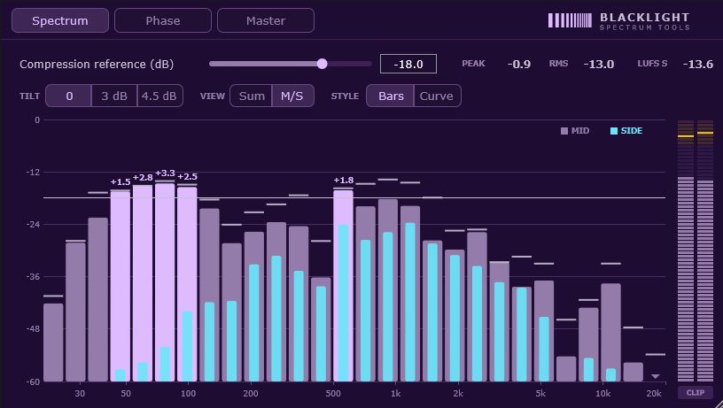
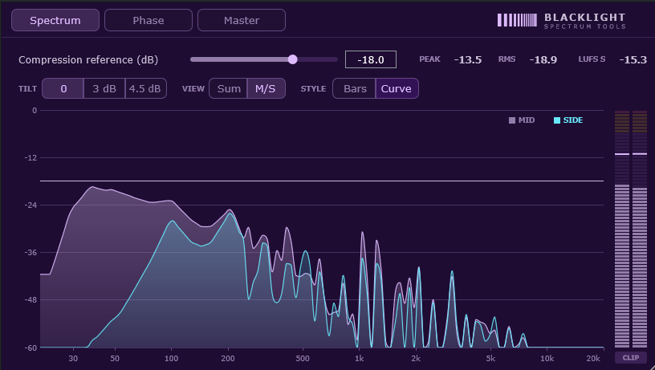
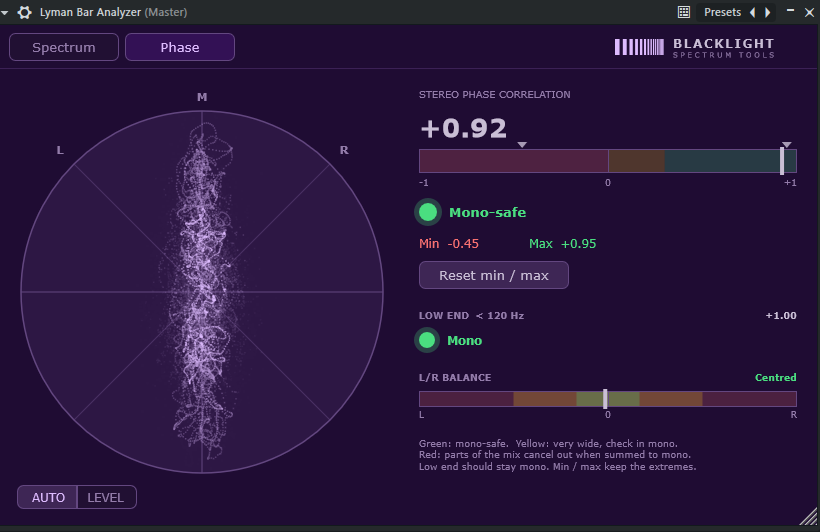
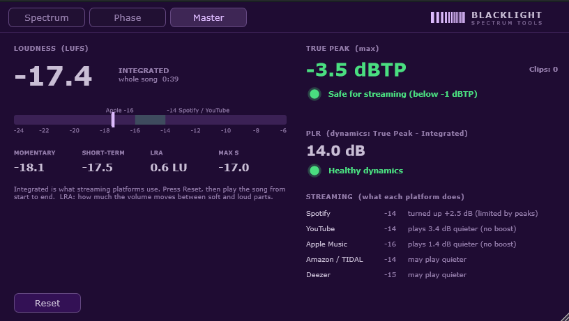

# Lyman Bar Analyzer (VST3)

**by Blacklight Spectrum Tools**

*[Read in English](README.md)*

Analizador de espectro de referencia que muestra la energía por banda de
frecuencia en **barras** (como un EQ gráfico) o en una **curva** detallada,
para ver qué bandas sobresalen y por cuánto, y decidir qué comprimir o
ecualizar. También revisa fase, ancho estéreo y volumen para streaming.

No modifica el audio: es solo un medidor, transparente en la señal.

**Gratis de verdad.** Sin demo, sin cuenta, sin caducidad. Lo que hoy es
gratis se queda gratis.

## Descargar

**[Descarga la versión más reciente (instalador para Windows)](https://github.com/blacklight-spectrum-tools/LymanBarAnalyzer/releases/latest)**

Abre `Lyman-Bar-Analyzer-...-Windows-Setup.exe` y luego vuelve a buscar
plugins en tu DAW. El instalador pone el plugin en
`C:\Program Files\Common Files\VST3\` y se puede quitar desde
Configuración de Windows → Aplicaciones.

> **Windows puede mostrar "Windows protegió tu PC".** El instalador todavía
> no está firmado, así que SmartScreen no lo reconoce. Dale a
> **Más información → Ejecutar de todas formas**. GitHub arma el
> instalador automáticamente a partir del código de este repositorio.

¿Prefieres copiarlo tú? Cada versión trae también un `.zip` con la carpeta
`.vst3`.









## Compatibilidad

Plugin VST3 para **Windows**, compatible con cualquier DAW que cargue
plugins VST3: FL Studio, Ableton Live, Cubase, Studio One, Reaper, Bitwig,
Cakewalk, Reason 12+ y otros.

Probado hasta ahora en FL Studio. Están planeadas versiones para Pro Tools
(AAX) y macOS (AU / VST3).

## Funciones

**Pestaña Spectrum**
- 28 barras espaciadas logarítmicamente entre 20 Hz y 20 kHz, calibradas:
  un tono a -20 dBFS marca -20 en su barra.
- Resolución real en graves: debajo de 240 Hz cada barra tiene su propio
  filtro, así que las bandas vecinas quedan 38 dB separadas. El kick y el
  bajo caen en barras distintas.
- Estilo **Barras o Curva**. La curva tiene 120 puntos (como 1/12 de
  octava) para ver resonancias angostas; lo que pasa la referencia se
  resalta.
- Línea de referencia de compresión: lo que la pasa se ilumina y muestra
  cuántos dB la rebasa (por ejemplo `+3.2`), el dato que necesitas para el
  umbral.
- Peak hold en cada barra.
- Tilt (0 / 3 / 4.5 dB por octava) para juzgar el balance tonal. Usa 0
  para poner el umbral de un compresor.
- Medidor de nivel L/R con zonas de intensidad (-12, -6 y -1 dB), lecturas
  de Peak, RMS y LUFS de corto plazo, y luz de CLIP que se queda encendida
  (clic para apagarla).
- Vista Sum o M/S: en M/S el canal Side se dibuja en cian, para ver qué
  frecuencias están abiertas y cuáles en el centro.

**Pestaña Phase**
- Goniómetro con escala Auto o Level (el borde es 0 dBFS).
- Medidor de correlación de fase de -1 a +1 con luz: verde (compatible con
  mono), amarillo (muy abierto, revisa en mono), rojo debajo de -0.3
  (partes de la mezcla se cancelan al sumar a mono).
- Mínimo y máximo de correlación alcanzados mientras suena, con reinicio.
- Revisión de graves: correlación de todo lo que está debajo de 120 Hz,
  con su propia luz. Te dice si lo ancho está en el grave, donde estorba,
  o solo en los agudos.
- Medidor de balance L/R.

**Pestaña Master**
- Sonoridad según ITU-R BS.1770 / EBU R128: **Integrated** (la canción
  completa, el número que usan las plataformas), Momentary, Short-term,
  LRA (rango de sonoridad) y máximos, con reinicio.
- **True Peak** con sobremuestreo 4x (el pico entre muestras, el que
  distorsiona al convertir a MP3/AAC), luz en -1 dBTP y contador de clips.
- **PLR** (True Peak menos Integrated): cuánto golpe le queda a tu master.
  Avisa cuando está sobrecomprimido.
- Qué harían Spotify, YouTube, Apple Music, Amazon / TIDAL y Deezer con tu
  nivel.

**En cualquier pestaña:** aviso de DC offset en la cabecera.

La ventana se puede redimensionar y recuerda su tamaño y la última pestaña
abierta.

## Uso

1. Vuelve a buscar plugins en tu DAW. En FL Studio: **Options → Manage
   Plugins → Find plugins**.
2. Inserta **"Lyman Bar Analyzer"** en la pista o bus que quieras
   medir. Muestra la señal tal como está en ese punto de la cadena: en el
   último slot ves lo que el canal realmente manda; antes de un compresor
   ves lo que el compresor recibe. También puedes usar dos instancias, una
   antes y otra después de un plugin, para comparar.
3. Mueve el slider de **referencia de compresión** hasta el nivel donde
   quieres que el compresor empiece a actuar. Lo que pasa la referencia se
   ilumina, y el número de arriba te dice por cuánto.
4. Abre la pestaña **Phase** para revisar el ancho estéreo y la
   compatibilidad con mono.
5. En el master, abre la pestaña **Master**, dale **Reset** y reproduce la
   canción completa para leer su sonoridad integrada, True Peak y PLR.

## Roadmap (versión gratuita)

Todo lo de esta lista es para la versión **gratuita**. Sin fechas: cada
versión sale cuando está probada en mezclas reales.

**Próxima versión (1.4) — en curso**

- [x] Curva más estable y con más detalle: promediada como SPAN, resolución de
      ~3 Hz en graves (las notas del kick y del bajo salen como picos separados)
- [x] Rango vertical (60 / 72 / 84 dB) y menú de configuración
- [x] Freeze y hold infinito de picos (lo más fuerte que llegó cada banda en
      toda la canción)
- [x] Lectura al pasar el mouse: frecuencia, nota musical, nivel, distancia a la
      referencia y veredicto Mid/Side por frecuencia
- [x] Botón de escucha Mono / Side (se mantiene presionado; se apaga solo
      al exportar)
- [ ] Aviso de fase por banda en la vista M/S
- [ ] Zonas por instrumento (por ejemplo voz: cuerpo, presencia, sibilancia,
      aire)
- [ ] Pestaña Master que sabe en qué canal está (tabla de streaming solo en el
      master)
- [ ] Modo de lecturas grandes para grabar pantalla y dar clases
- [ ] Modos de color: grafito neutro (descansa la vista en sesiones largas),
      atenuado y para daltonismo

**Más adelante**

- [ ] Fantasma de canal: ver la curva de otro canal detrás de la tuya para
      detectar enmascaramiento
- [ ] Revisión de notas kick / bajo (¿están chocando?)
- [ ] Vista de 31 bandas ISO
- [ ] macOS (AU y VST3)

Ideas y comentarios son bienvenidos en
[Issues](https://github.com/blacklight-spectrum-tools/LymanBarAnalyzer/issues).

## Compilar desde el código

Solo hace falta si quieres modificar el código; para usar Lyman basta con
el instalador de arriba.

**Requisitos:** Git, CMake 3.15 o más reciente, y Visual Studio 2022 o más
reciente (o sus Build Tools) con el componente "Desktop development with
C++". JUCE viene incluido como submódulo de git.

```
git clone --recurse-submodules https://github.com/blacklight-spectrum-tools/LymanBarAnalyzer.git
cd LymanBarAnalyzer
cmake -S . -B build -A x64
cmake --build build --config Release
```

Si lo clonaste sin `--recurse-submodules` y la carpeta `JUCE/` está vacía,
corre `git submodule update --init`.

El plugin queda en
`build/BarSpectrumAnalyzer_artefacts/Release/VST3/Lyman Bar Analyzer.vst3`.
La compilación también intenta copiarlo a
`C:\Program Files\Common Files\VST3\`; eso requiere permisos de
administrador, así que un `Permission denied` al final solo significa que
tienes que copiar la carpeta `.vst3` a mano (o usar
`-DLYMAN_COPY_AFTER_BUILD=OFF`).

Las versiones anteriores (la 1.0 y "Bar Spectrum Analyzer Dev") usan otros
identificadores de plugin, así que pueden seguir instaladas junto a Lyman y
tus proyectos viejos las siguen encontrando.
