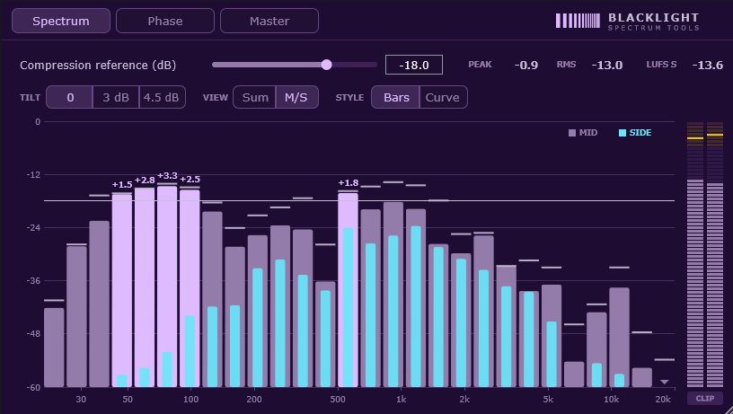
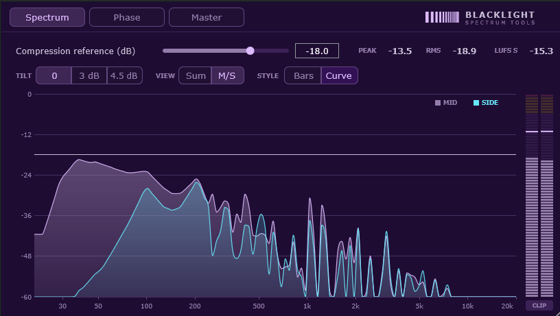
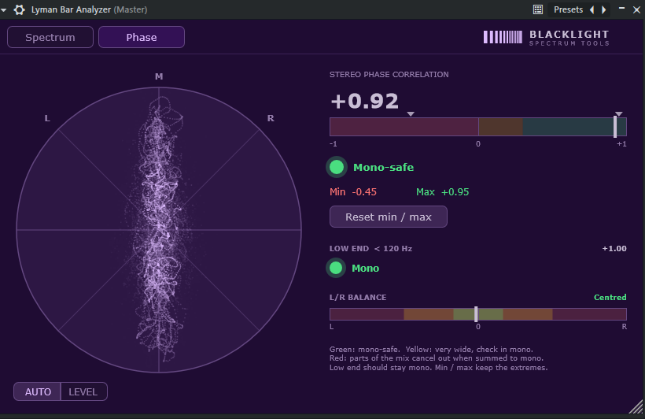
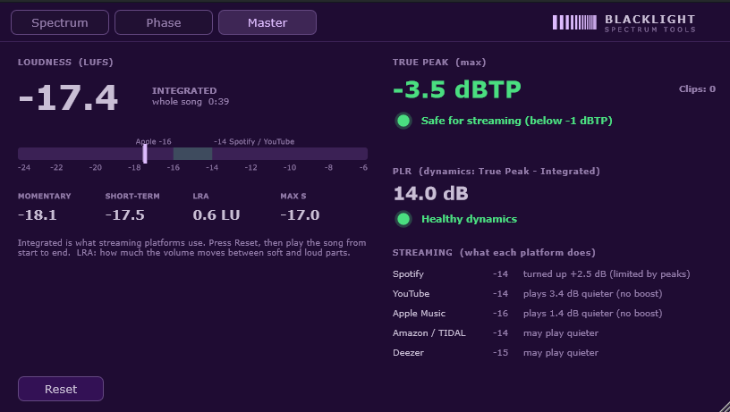

# Lyman Bar Analyzer (VST3)

**by Blacklight Spectrum Tools**

*[Leer en español](README.es.md)*

A reference spectrum analyzer that shows energy per frequency band as
**bars** (like a graphic EQ) or as a detailed **curve**, so you can see which
bands stand out and by how much, and decide what to compress or EQ. It also
checks phase, stereo width and loudness for streaming.

It never changes your mix: it is a meter. The only control that touches
the audio is the Mono / Side listen button, which only works while you
listen and turns itself off on export.

**Free. Really.** No trial, no account, no expiry. What's free today stays
free.

## Download

**[Download the latest version (Windows installer)](https://github.com/blacklight-spectrum-tools/LymanBarAnalyzer/releases/latest)**

Run `Lyman-Bar-Analyzer-...-Windows-Setup.exe`, then rescan plug-ins in your
DAW. The installer puts the plugin in `C:\Program Files\Common Files\VST3\`
and can be removed from Windows Settings → Apps.

> **Windows may show "Windows protected your PC".** The installer is not
> code-signed yet, so SmartScreen does not recognise it. Click
> **More info → Run anyway**. The installer is built automatically by
> GitHub from the source code in this repository.

Prefer to copy it yourself? Each release also has a `.zip` with the
`.vst3` folder.









## Compatibility

VST3 plugin for **Windows**, compatible with any DAW that loads VST3
plugins: FL Studio, Ableton Live, Cubase, Studio One, Reaper, Bitwig,
Cakewalk, Reason 12+ and others.

Tested so far in FL Studio. Pro Tools (AAX) and macOS (AU / VST3) builds
are planned.

## Features

**Spectrum tab**
- 28 bars, logarithmically spaced from 20 Hz to 20 kHz, calibrated: a tone
  at -20 dBFS reads -20 in its bar.
- Real low-end resolution: below 240 Hz each bar has its own filter, so
  neighbouring bands are 38 dB apart. Kick and bass land in different bars.
- **Bars or Curve** style. Bars react instantly (to decide); the curve is
  averaged like SPAN (to compare), with 240 points and ~3 Hz resolution in
  the low end, so kick and bass notes show as separate peaks. Curve speed:
  Fast / Normal / Slow.
- Compression reference line: whatever goes above it lights up and shows by
  how many dB it exceeds it (e.g. `+3.2`), the number you need for the
  threshold.
- Peak hold on every bar: normal (falls after 1 s) or **infinite** (the
  loudest each band got in the whole song; double-click to reset).
- **Freeze** the display to study it (meters keep running).
- **Hover readout:** frequency, musical note (e.g. `52 Hz · G#1 +3¢`),
  level and distance to the reference. In M/S it also tells you how far
  Side is from Mid and what that means (mostly mono, stereo, wide, or
  phase cancellation risk).
- **Per-band phase warning:** a red mark on any band that would cancel when
  summed to mono, with what to check (polarity, L/R delay, widener). Tuned
  not to fire on normal stereo (reverbs, pads).
- Tilt (0 / 3 / 4.5 dB per octave) to judge tonal balance. Use 0 when
  setting a compressor threshold.
- L/R level meter with intensity zones (-12, -6 and -1 dB), Peak, RMS and
  short-term LUFS readouts, plus a latching CLIP light (click to reset).
- Sum or M/S view: in M/S the Side channel is drawn in cyan, so you can see
  which frequencies are wide and which sit in the center.
- Vertical range 60 / 72 / 84 dB, in the settings menu (gear next to the
  logo).

**Phase tab**
- Goniometer with Auto scale or Level scale (the edge is 0 dBFS).
- Phase correlation meter from -1 to +1 with a warning light: green
  (mono-safe), yellow (very wide, check in mono), red below -0.3 (parts of
  the mix cancel out when summed to mono).
- Minimum / maximum correlation reached while playing, with reset.
- Low end check: correlation of everything below 120 Hz, with its own
  light. Tells you whether the width is in the bass, where it hurts, or
  only in the highs.
- L/R balance meter.

**Master tab**
- Loudness per ITU-R BS.1770 / EBU R128: **Integrated** (the whole song,
  the number streaming platforms use), Momentary, Short-term, LRA
  (loudness range) and maximums, with reset.
- **True Peak** with 4x oversampling (the peak between samples, the one that
  distorts on MP3/AAC conversion), a light for -1 dBTP and a clip counter.
- **PLR** (True Peak minus Integrated): how much punch is left. Warns when
  the master is over-compressed.
- What Spotify, YouTube, Apple Music, Amazon / TIDAL and Deezer would do
  with your level.

**Anywhere:**
- **MONO / SIDE listen button** in the header: hold it to listen, release to
  go back to stereo; right-click (or Shift+click) to lock it. It can be
  linked to a MIDI pad (in FL Studio: right-click the "Listen" parameter →
  Link to controller). It never stays on: a project always opens in stereo,
  and exports are never affected.
- A DC offset warning in the header.

The window is resizable and remembers its size and last open tab.

## Using it

1. Rescan plugins in your DAW. In FL Studio: **Options → Manage Plugins →
   Find plugins**.
2. Insert **"Lyman Bar Analyzer"** on the track or bus you want to
   measure. It shows the signal exactly as it is at that point of the chain:
   in the last slot you see what the channel really sends out; before a
   compressor you see what the compressor receives. You can also use two
   instances, one before and one after a plugin, to compare.
3. Move the **compression reference** slider to the level where you want
   the compressor to start working. Whatever goes above it is highlighted,
   and the number on top tells you by how much.
4. Open the **Phase** tab to check stereo width and mono compatibility.
5. On the master, open the **Master** tab, press **Reset** and play the
   whole song to read its integrated loudness, True Peak and PLR.

## Roadmap (free version)

Everything below is planned for the **free** version. No dates: each release
ships when it is tested in real mixes.

**1.4 — released**

- [x] Smoother, more detailed curve: averaged like SPAN, ~3 Hz resolution in the
      low end (kick and bass notes show as separate peaks)
- [x] Vertical range (60 / 72 / 84 dB) and a settings menu
- [x] Freeze and infinite peak hold (the loudest each band got in the whole song)
- [x] Hover readout: frequency, musical note, level, distance to the reference,
      and Mid/Side verdict per frequency
- [x] Mono / Side listen button (hold to listen; turns itself off on export)
- [x] Per-band phase warning (red mark where a band would cancel in mono)

**Next release (1.5) — in progress**

- [ ] Instrument zones (e.g. voice: body, presence, sibilance, air)
- [ ] Master tab aware of the channel it is on (streaming table only on the master)
- [ ] Large readings mode for screen recording and teaching
- [ ] Colour modes: neutral graphite (easy on the eyes in long sessions), dim
      and colour-blind friendly
- [ ] Redesigned settings menu and tooltips

**Later**

- [ ] Channel ghost: see another channel's curve behind yours to spot masking
- [ ] Kick / bass note check (are they clashing?)
- [ ] 31-band ISO view
- [ ] macOS (AU and VST3)

Ideas and feedback are welcome in
[Issues](https://github.com/blacklight-spectrum-tools/LymanBarAnalyzer/issues).

## Building from source

Only needed if you want to change the code; the installer above is all you
need to use Lyman.

**Requirements:** Git, CMake 3.15 or newer, and Visual Studio 2022 or newer
(or its Build Tools) with the "Desktop development with C++" workload. JUCE
is included as a git submodule.

```
git clone --recurse-submodules https://github.com/blacklight-spectrum-tools/LymanBarAnalyzer.git
cd LymanBarAnalyzer
cmake -S . -B build -A x64
cmake --build build --config Release
```

If you cloned without `--recurse-submodules` and the `JUCE/` folder is
empty, run `git submodule update --init`.

The plugin is built at
`build/BarSpectrumAnalyzer_artefacts/Release/VST3/Lyman Bar Analyzer.vst3`.
The build also tries to copy it to `C:\Program Files\Common Files\VST3\`;
that needs administrator rights, so a final `Permission denied` only means
you have to copy the `.vst3` folder there by hand (or pass
`-DLYMAN_COPY_AFTER_BUILD=OFF`).

Earlier builds (version 1.0 and "Bar Spectrum Analyzer Dev") use different
plugin IDs, so they can stay installed next to Lyman and your old projects
keep finding them.
